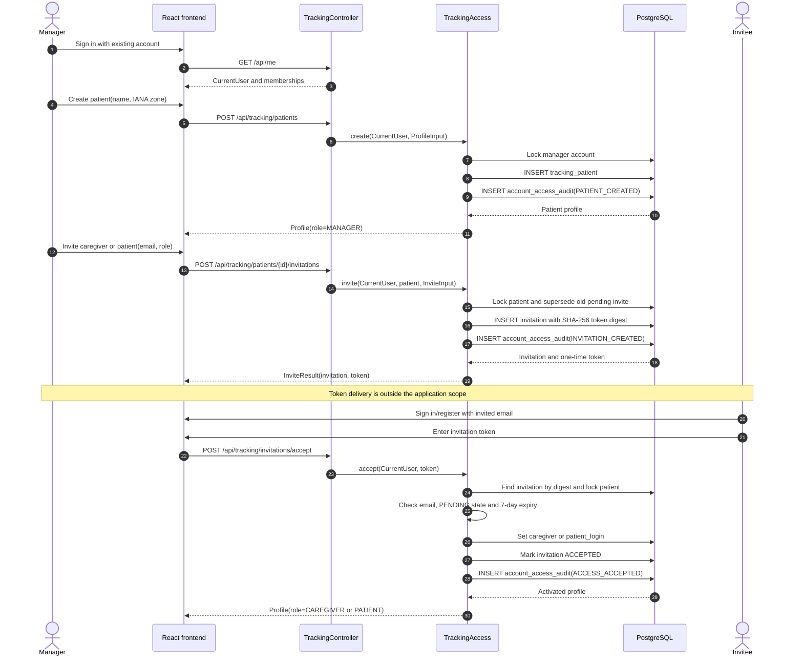
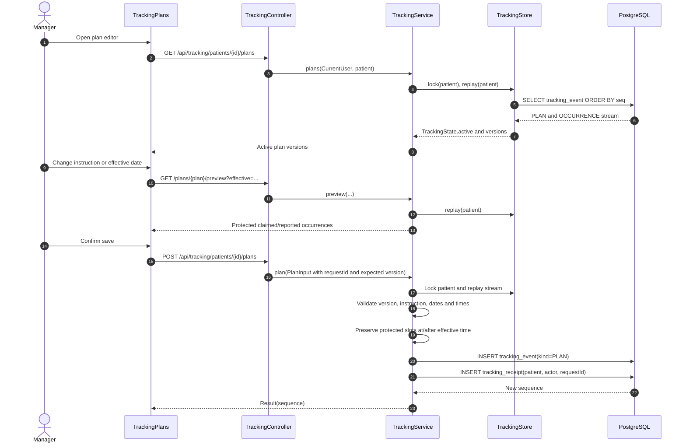
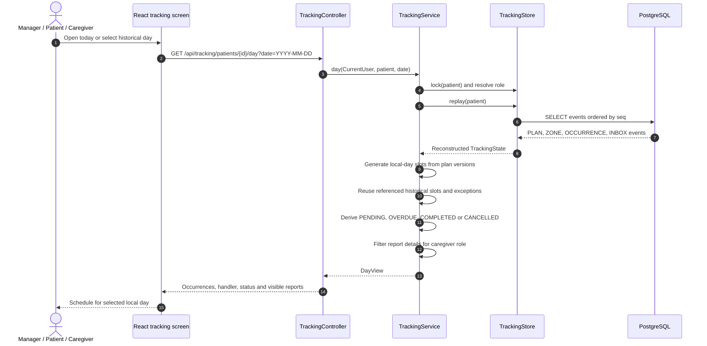
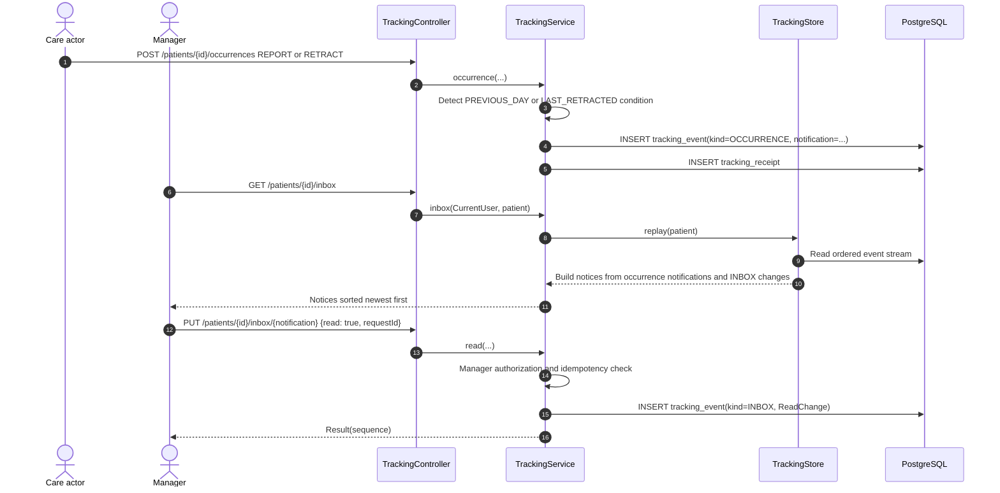
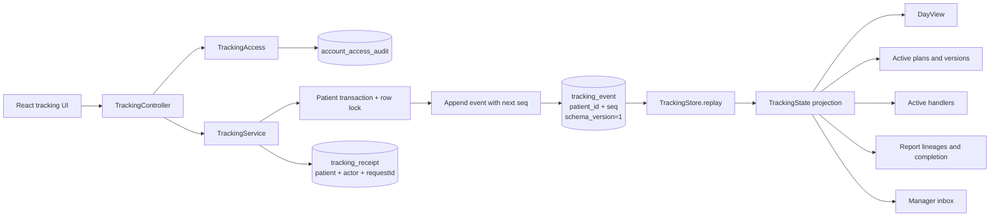

# Tracking use cases and event flows

This document describes the current implementation of the PostgreSQL-backed tracking workspace. It is based on `TrackingController`, `TrackingAccess`, `TrackingService`, `TrackingStore` and `TrackingState`.

The diagrams use Mermaid and render in GitHub, GitLab and most Markdown viewers that support Mermaid.

## Actors and implementation boundaries

| Actor | Current responsibility |
| --- | --- |
| Manager | Creates the patient profile, manages invitations and plans, can cancel/reopen events, reads the inbox and can replace a caregiver. |
| Patient | Reads their own schedule and can submit, correct and retract their own reports. |
| Caregiver | Reads shared status and their own report history; can claim, release, take over and report care. |
| Frontend | React tracking screens call the REST API with stateless HTTP Basic authentication. |
| Tracking API | Spring controller and services enforce role, state, idempotency and concurrency checks. |
| Event store | `tracking_event` stores one ordered stream per patient. Each request replays the stream into `TrackingState`. |
| PostgreSQL | Stores accounts, access relationships, invitations, event streams, idempotency receipts and access audit records. |

Per-patient roles are resolved from `tracking_patient`; Spring authorities are not used for these permissions. A pending invitation does not grant access.

## Use case 1: account, patient and invitation activation

The MVP does not deliver email or SMS itself. The manager receives the invitation token from the API/UI flow and supplies it to the invited account through an external channel.



### Access rules implemented here

- One manager may create one tracking patient in the MVP.
- A patient has one manager, at most one caregiver and at most one patient login.
- A patient login and caregiver cannot be activated from a pending invitation unless the invitation email matches the authenticated account.
- Caregiver replacement/revocation is rejected while that caregiver still owns active claims.
- Invitation revocation and caregiver revocation are manager-only operations.

## Use case 2: create or edit a medication/procedure plan

Plans are versioned. A plan edit is a preview-then-commit operation: the client first reads the current version and protected occurrences, then submits the version it previewed.



A new plan creates a `Version`; an edit closes the previous version at the effective instant and creates a replacement. Reported or claimed future occurrences are carried as exceptions so that an edit cannot silently rewrite active handling or historical reports. Setting `stop=true` closes the plan without creating a replacement.

The same patient-zone change path creates a `ZONE` event for each active plan. Historical slots retain their original version and scheduled instant; future slots use the new IANA zone.

## Use case 3: read a day and derive occurrence status

A day read does not write an event. The service locks the patient row, replays the complete patient stream, generates slots from plan versions in the patient or version time zone, and derives the current status.



Status derivation is deterministic:

1. Explicit cancellation or a stopped plan makes an occurrence `CANCELLED` unless an exception preserves that slot.
2. Any author with a non-retracted latest report makes the occurrence `COMPLETED`.
3. Otherwise, an occurrence whose scheduled instant is in the past is `OVERDUE`.
4. All other occurrences are `PENDING`.

The completion time is the earliest `actual` time among the latest valid reports. The API returns full report history to managers/patients and only the caregiver's own report history to a caregiver.

## Use case 4: claim, report care and concurrent completion

Claiming is optional. A caregiver can report without a claim. A claim is closed as soon as any valid actor reports completion.

```mermaid
sequenceDiagram
    autonumber
    actor C as Caregiver
    actor P as Patient or manager
    participant F as React tracking screen
    participant API as TrackingController
    participant S as TrackingService
    participant Store as TrackingStore
    participant DB as PostgreSQL

    C->>F: Claim occurrence
    F->>API: POST /patients/{id}/occurrences {action: CLAIM, requestId}
    API->>S: occurrence(...)
    S->>Store: Lock patient and replay stream
    S->>S: Require open incomplete status and no handler
    S->>DB: INSERT OCCURRENCE(CLAIM, next handler)
    S->>DB: INSERT tracking_receipt
    DB-->>S: sequence
    S-->>F: Result(sequence)

    par Another actor reports first
        P->>API: POST /patients/{id}/occurrences {action: REPORT, actual, requestId}
        API->>S: occurrence(...)
        S->>Store: Lock patient and replay latest stream
        S->>S: Validate actual <= now and acknowledgment if needed
        S->>DB: INSERT OCCURRENCE(REPORT)
        Note over S: Report clears the active handler and derives COMPLETED
        S-->>P: Result(sequence)
    and Caregiver submits against stale view
        C->>API: POST /patients/{id}/occurrences {action: REPORT, acknowledgment?}
        API->>S: occurrence(...)
        S->>Store: Lock patient and replay latest stream
        S->>S: Recheck completion revision
        S-->>C: 409 conflict when acknowledgment is stale
    end

    C->>API: POST /patients/{id}/occurrences {action: RELEASE, expectedHandler}
    API->>S: occurrence(...)
    S->>S: Only current handler may release; compare expected handler
    S->>DB: INSERT OCCURRENCE(RELEASE)
    S-->>C: Result(sequence)

    C->>API: POST /patients/{id}/occurrences {action: TAKEOVER, reason, expectedHandler}
    API->>S: occurrence(...)
    S->>S: Require reason and compare expected handler
    S->>DB: INSERT OCCURRENCE(TAKEOVER)
    S-->>C: Result(sequence)
```

The database transaction and patient row lock serialize commands for one patient. `requestId` is scoped to `(patient, actor)` and is fingerprinted. Retrying the same command returns the original response; reusing the same request ID with a different payload returns `409 Conflict`.

## Use case 5: correction, retraction, cancellation and reopening

Reports are append-only per author and occurrence. A correction or retraction references the expected report revision and must include a reason.

```mermaid
sequenceDiagram
    autonumber
    actor A as Original report author
    actor M as Manager
    participant F as React tracking screen
    participant API as TrackingController
    participant S as TrackingService
    participant DB as PostgreSQL

    A->>F: Correct or retract own report
    F->>API: POST /patients/{id}/occurrences {action, author, reportRevision, reason}
    API->>S: occurrence(...)
    S->>S: Verify author, reason and latest report revision
    alt CORRECT
        S->>DB: INSERT OCCURRENCE(CORRECT, new actual time)
    else RETRACT
        S->>DB: INSERT OCCURRENCE(RETRACT)
        S->>S: If last valid report, attach LAST_RETRACTED notification
    end
    S-->>F: Result(sequence)

    M->>API: POST /patients/{id}/occurrences {action: CANCEL, requestId}
    API->>S: occurrence(...)
    S->>S: Manager-only; reject claimed, reported or already cancelled slot
    S->>DB: INSERT OCCURRENCE(CANCEL)
    S-->>M: Result(sequence)

    M->>API: POST /patients/{id}/occurrences {action: REOPEN, requestId}
    API->>S: occurrence(...)
    S->>S: Manager-only; require CANCELLED status
    S->>DB: INSERT OCCURRENCE(REOPEN)
    S-->>M: Result(sequence)
```

A normal report is rejected while an occurrence is cancelled. Reopening does not erase the cancellation event; replay applies the complete lifecycle history.

## Use case 6: inbox notification and read state

Notifications are generated inside the occurrence command and become visible after replay. The current implementation creates notifications for a report on a previous patient-local day and for retraction of the last valid report.



A report on the current patient-local day, a non-final retraction and a repeated read value do not create an additional notification event. Read state is reconstructed from the stream and survives retries and process restarts.

## Event stream and projections

Each patient owns an append-only stream in `tracking_event`:



### Event kinds currently persisted

| Kind | Written by | Payload meaning | Projection effect |
| --- | --- | --- | --- |
| `PLAN` | `POST /patients/{id}/plans` | New/replacement instruction, effective instant, stop flag and protected slots | Adds a version, closes an earlier version, stops a plan or preserves exceptions. |
| `ZONE` | Patient profile update when zone changes | Previous version, replacement version, effective instant and protected slots | Closes the old zone version and activates a future version without rewriting historical slots. |
| `OCCURRENCE` | Occurrence command | Slot, action, actual time, reason, author, previous/next handler and optional notification | Applies claim lifecycle, report lineage, cancellation lifecycle and notification creation. |
| `INBOX` | Manager read/unread mutation | Notification ID and target read state | Updates the projected read state. |

`schema_version` is currently `1`; replay rejects an unsupported version or a sequence gap. The event payload is JSON text. There is no separate background message broker: notification creation and event append happen in the same request transaction.

### Separate durable records

- `tracking_patient` stores the current access relationship and patient time zone.
- `tracking_invitation` stores only the invitation token digest, role, email, expiry and state.
- `tracking_receipt` stores the request fingerprint and response for idempotent commands.
- `account_access_audit` stores before/after access states for patient creation, profile changes, invitation changes, activation and revocation. Passwords and password hashes are not written to this audit.

## API command summary

| Method | Endpoint | Use |
| --- | --- | --- |
| `GET` | `/api/tracking/patients` | List profiles visible to the authenticated actor. |
| `POST` | `/api/tracking/patients` | Create a manager-owned patient profile. |
| `PUT` | `/api/tracking/patients/{patient}` | Update name or time zone; may append `ZONE` events. |
| `POST` | `/api/tracking/patients/{patient}/invitations` | Create or replace a pending caregiver/patient invitation. |
| `POST` | `/api/tracking/invitations/accept` | Accept a valid invitation for the authenticated email. |
| `GET` | `/api/tracking/patients/{patient}/day` | Read a role-filtered day projection. |
| `GET` | `/api/tracking/patients/{patient}/plans` | Read manager-visible active plans. |
| `GET` | `/api/tracking/patients/{patient}/plans/{plan}/preview` | Preview protected occurrences before an edit. |
| `POST` | `/api/tracking/patients/{patient}/plans` | Create, replace or stop a plan; appends `PLAN`. |
| `POST` | `/api/tracking/patients/{patient}/occurrences` | Claim, release, take over, report, correct, retract, cancel or reopen. |
| `GET` | `/api/tracking/patients/{patient}/claims` | Read manager-visible active claims. |
| `GET` | `/api/tracking/patients/{patient}/inbox` | Read the manager inbox projection. |
| `PUT` | `/api/tracking/patients/{patient}/inbox/{notification}` | Append an inbox read-state change. |

## What is intentionally outside the current implementation

- External email/SMS/push delivery for invitations or notifications.
- A background event broker or asynchronous notification worker.
- Backfill of legacy browser-demo marks or legacy dose logs into tracking reports.
- Customer export and destructive care-history deletion.
- Many-to-many care circles; the MVP keeps one manager, one caregiver and one patient login per profile.
